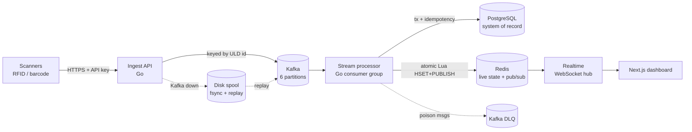

# Real-Time ULD Tracking Engine


An event-driven platform for air-cargo ground operations. It tracks every
**Unit Load Device (ULD)**, the pallets and containers loaded onto aircraft.
Warehouse RFID and barcode scanners stream telemetry into a Go ingestion API.
Kafka buffers the stream, and a stream processor persists each scan to
PostgreSQL and projects live state into Redis. A WebSocket server then pushes
every change to a Next.js operations dashboard within milliseconds. The
dashboard shows ULD positions on a warehouse map and weight against each
aircraft's structural limits. Overloads are flagged before a ULD reaches the
ramp. The system is also designed for failure: a Kafka outage loses no
telemetry, and every service emits SIEM-ready security events for a Security
Operations Center (SOC).

## System architecture



| Component | Role |
|---|---|
| **Ingest API** (Go) | Authenticates scanners, validates batches and publishes them to Kafka keyed by ULD id. Every 202 means the scan is durable. |
| **Kafka** (KRaft) | Six partitions. Keying by ULD id gives strict per-ULD ordering while partitions process in parallel. |
| **Stream processor** (Go) | A consumer group with one goroutine per partition. It applies each scan in one Postgres transaction that is idempotent on `event_id`, rejects out-of-order events, and runs the weight and security detections. |
| **PostgreSQL** | System of record: aircraft, flights, ULD state and an append-only scan log. |
| **Redis** | Live ULD and flight-load projection. A version-guarded Lua script writes state and publishes the change atomically, so stale updates can never win. |
| **Realtime** (Go) | A WebSocket hub where one goroutine owns the client set. It uses per-client read and write pumps, disconnects slow clients, and resyncs reconnecting clients from a snapshot. |
| **Dashboard** (Next.js + Tailwind) | Live warehouse map, sortable ULD manifest, flight-load gauges and weight alerts. It applies updates in batches so a burst of scans costs only a few renders. |

## Security & resilience

**Kafka outage, no data loss.** When the broker is unreachable, ingest
switches to degraded mode. It fsyncs every batch to an append-only disk spool
before acknowledging it, then replays the spool in order once Kafka returns.
A 202 always means durable. Clients retry with the same `event_id`, and the
processor absorbs Kafka-level redeliveries through idempotency, so delivery
is at-least-once but the results are effectively-once.

[`scripts/chaos-test.sh`](scripts/chaos-test.sh) freezes the broker
(`docker compose pause`) and then crashes it (`kill -9`) under 30 scans/s
load. [`cmd/verify`](backend/cmd/verify) then reconciles every acknowledged
`event_id` against Postgres, checking for loss, duplication, ordering and the
Redis projection. Validated on a local fault-injection harness:

```
5551 acknowledged (3017 via disk spool) → 5551 persisted · 0 lost · 0 duplicated · 73 Kafka redeliveries absorbed
ingest SIGKILLed mid-outage holding 427 spooled scans → all recovered on restart
```

**SOC telemetry.** Every service writes strictly one JSON object per line to
stdout, using `log/slog` with **Elastic Common Schema** field names, ready
for Security Onion and Elastic. Security events carry stable rule IDs:

| Category | Rules |
|---|---|
| Authentication / authorization | missing or malformed credentials, invalid or **revoked** API key, missing scope, per-source **brute force** |
| Geographic anomaly | **impossible travel**: a ULD scanned at two airports faster than an aircraft could fly between them |
| Data integrity | weight implausibly over design limits, below empty weight, or changed after loading |
| Pipeline | dead-letter routing (logs a payload hash, never the payload), Kafka outage and recovery |

API keys are stored only as SHA-256 hashes, and raw credentials never reach
the logs. Spoofable `X-Forwarded-For` headers are recorded but never trusted.
Detections run inside the processing transaction and are stored on the scan
row, so a Kafka redelivery never raises a duplicate alert. See
[docs/RUNBOOK.md](docs/RUNBOOK.md) for the rule catalogue, sample events, a
Filebeat config and correlation queries.

## Server deployment quickstart

On a fresh Ubuntu 22.04 or 24.04 server:

```bash
# 1. Docker Engine + Compose plugin
curl -fsSL https://get.docker.com | sudo sh
sudo usermod -aG docker "$USER" && newgrp docker
sudo apt-get install -y jq git

# 2. Clone and start the stack (waits until every healthcheck passes)
git clone https://github.com/radithyama/uld-tracking-engine.git
cd uld-tracking-engine
export ALLOWED_ORIGINS="http://$(curl -fsS ifconfig.me):3000"   # dashboard origin for the WebSocket
docker compose up -d --build --wait

# 3. Optional: synthetic scanner traffic, then an end-to-end check
docker compose --profile sim up -d --wait simulator
scripts/verify-stack.sh
```

For the dashboard, run it on the server with Node 20+ as below, or deploy
`frontend/` to Vercel with the same environment variable:

```bash
cd frontend && npm ci
NEXT_PUBLIC_WS_URL="ws://<server-ip>:8081/ws" npm run build && npm start   # http://<server-ip>:3000
```

> **Before exposing this publicly:**
> * Postgres, Redis, Kafka and the internal metrics and control ports are
>   bound to `127.0.0.1`. Only ingest (8080) and realtime (8081) are
>   published.
> * Docker-published ports bypass `ufw`, so restrict them with your cloud
>   firewall.
> * Replace the dev API keys in `backend/config/api-keys.dev.json` and the
>   default Postgres password.
> * Put TLS (for example Caddy or nginx) in front of 8080 and 8081.

## Validate it yourself

```bash
make verify-stack      # health + probe scan through every hop
make chaos             # Kafka pause + kill under load, then reconcile
make security-smoke    # trigger every detection rule and assert it was logged
make test              # Go unit tests with the race detector
```

## Repository layout

```
backend/    Go services: cmd/{ingest,processor,realtime,simulator,verify}, internal/*, migrations/
frontend/   Next.js 16 dashboard
scripts/    stack verification, chaos test, security smoke test
docs/       ARCHITECTURE.md (deep dive) · RUNBOOK.md (operations & SOC telemetry)
```

## Further reading

* [docs/ARCHITECTURE.md](docs/ARCHITECTURE.md): API contract, concurrency
  model and delivery guarantees
* [docs/RUNBOOK.md](docs/RUNBOOK.md): validation, chaos testing and SIEM
  integration
